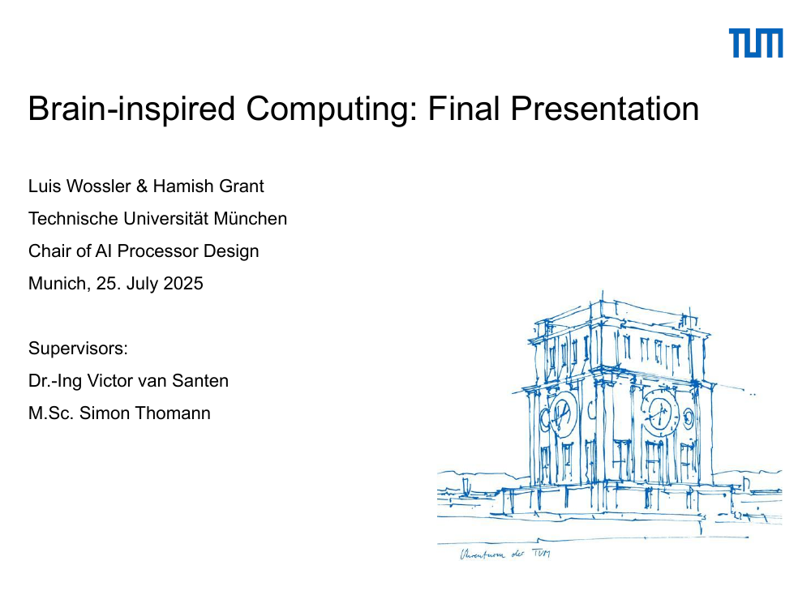

# final_project_bic

## Brain Inspired Computing Final Project 

## Papers

### 2T2R RRAM-Based In-Memory Hyperdimensional Computing
 https://ieeexplore.ieee.org/stamp/stamp.jsp?tp=&arnumber=10388038

- efficient in memory implementation 
- interesting section: _C. AM Architecture_

### RRAM for Compute-in-Memory: From Inference to Training
https://ieeexplore.ieee.org/stamp/stamp.jsp?tp=&arnumber=9406197

### Fully-Binarized, Parallel, RRAM-based Computing Primitive for In-Memory Similarity Search
https://arxiv.org/pdf/2208.02651v1

- this might be the perfect paper for modeling the Cell

## Questions
- what options of software optimizing are there
- the final project only considers inference forming and not training? 

## Goals 
- Maximize Inference Accuracy, while minimizing energy consumption. 

## Read Our Presentation

